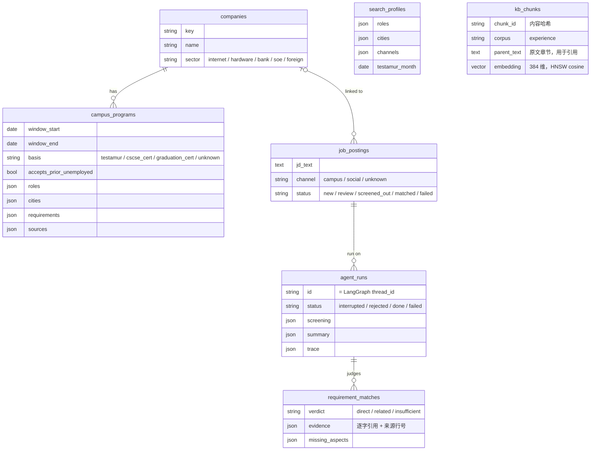

# 国内求职 Agent（cn-job-agent）

用多个 Agent 协作查找国内的 Agent 开发、AI 全栈、数据和技术支持岗位：先确认求职意向，再按届别窗口、城市和证据匹配筛选岗位。经历库和证据检索复用 [job_rag_starter](../job_rag_starter)。

> 当前完成 **P1**：粘贴一个 JD，由 LangGraph 调度筛选 Agent 和匹配 Agent，给出带原文引用的中文匹配报告。岗位采集和 React 前端在后续阶段加入，见文末路线图。

## Agent 图（P1）


| 节点 | 做什么 |
| --- | --- |
| `rule_screen` | 不用模型，逐句检查工作年限、博士学历、第一学历 985/211、QS 排名、年龄、实习岗、外语、城市，以及已知企业的校招届别窗口。每条结论都附 JD 原文 |
| `extract` | 复用 job_rag_starter 的 `jd_parser`：本地模型把 JD 拆成逐条要求，引用必须能在原文里逐字找到 |
| `decide` | 规则结论和模型提取的经验要求交叉核对：硬性不符直接筛掉，有疑问的交给你确认；模型单方面的判断从不直接筛掉岗位 |
| `human_review` | `interrupt()` 暂停，进度存在 PostgreSQL（`PostgresSaver`）；隔天在另一个进程里 `--approve` 也能接着跑 |
| `match_one` | 用 `Send` 每条要求一个分支并行跑，复用 job_rag_starter 的 `EvidenceMatcher`（direct / related / insufficient 和逐字引用校验），检索换成 pgvector |
| `finalize` | 写 `outputs/<运行编号>/report.md` 和 `result.json`，结果写进 `agent_runs` 和 `requirement_matches` 表 |

运行失败时（比如模型服务断了），已完成的分支保存在检查点里，`cn-agent run --resume <运行编号>` 只重跑没完成的部分。

## P0 包含什么

| 部分 | 说明 |
| --- | --- |
| PostgreSQL 17 + pgvector | `compose.yaml` 一键启动；Alembic 管理表结构 |
| 复用 job_rag_starter | 按文件路径只读加载它的 `search_experience.py`：章节切分、个人贡献优先、token 窗口、排序都用同一份代码，经历库也只有一份 |
| 持久化向量检索 | 旧系统每次运行都在内存里重新编码；这里把 E5 向量存进 pgvector（HNSW 索引），只重新编码内容变了的片段。`cn-agent parity` 验证结果和旧系统一致 |
| 校招窗口数据 | `data/seed/campus_2027.yaml`：约 100 家大企业的 2027 届毕业时间窗口、城市、岗位、限制条件和来源链接，整理自 2026-11-21 的联网调研 |
| 届别判断 | `eligibility.py`：按学位证月份（或留服认证日期）判断每个校招项目是否符合，窗口卡在当月的标为"卡在边界" |
| 求职画像 | `profile.local.yaml`（不进 git）：岗位类型、城市、渠道和判断届别用的日期 |

## 表结构



## 快速开始（Windows PowerShell）

需要 Python 3.11+、Docker Desktop，以及本机的 job_rag_starter（经历库和缓存好的 E5 模型）。

```powershell
py -3.14 -m venv .venv
.\.venv\Scripts\python.exe -m pip install -e ".[test]"
Copy-Item .env.example .env                       # 改掉 POSTGRES_PASSWORD 和 CN_DATABASE_URL 里的密码
Copy-Item profile.example.yaml profile.local.yaml # 填自己的岗位、城市和学位证月份
docker compose up -d db
.\.venv\Scripts\cn-agent.exe setup                # 迁移 + 导入校招数据 + 画像 + 经历入库
.\.venv\Scripts\cn-agent.exe doctor
```

匹配一个 JD（需要 job_rag_starter 的 `config.local.json` 里配置的本地模型正在运行）：

```powershell
.\.venv\Scripts\cn-agent.exe llm check
.\.venv\Scripts\cn-agent.exe jd add --file examples\sample_jd_agent.txt --city 深圳 --channel social
.\.venv\Scripts\cn-agent.exe jd add --clipboard --company 某公司 --city 杭州   # 从剪贴板粘贴
.\.venv\Scripts\cn-agent.exe run 1                                         # 筛选 + 匹配
.\.venv\Scripts\cn-agent.exe run --resume <运行编号> --approve              # 回答"是否继续"
.\.venv\Scripts\cn-agent.exe runs
.\.venv\Scripts\cn-agent.exe graph                                         # 打印 Agent 图
```

`examples/sample_jd_agent.txt` 是虚构的示例 JD。

常用命令：

```powershell
.\.venv\Scripts\cn-agent.exe search "RAG 检索增强 证据校验"
.\.venv\Scripts\cn-agent.exe parity "Agent 开发" "数据分析 SQL" "技术支持 工单"
.\.venv\Scripts\cn-agent.exe companies              # 画像城市里届别符合或待核实的项目
.\.venv\Scripts\cn-agent.exe companies --city 武汉 --all
```

测试（`pg` 标记的测试会新建并删除一个 `*_test` 数据库）：

```powershell
.\.venv\Scripts\python.exe -m pytest
```

## 数据与隐私

- `.env`、`profile.local.yaml` 不进 git。经历库留在 job_rag_starter 里，这个仓库不复制任何经历原文。
- 向量和经历片段只存在本机的 PostgreSQL 里。
- 校招数据大多来自高校就业网转载和第三方聚合站（`confidence` 字段标明），**投递前一定以企业官网公告为准**。

## 路线图

| 阶段 | 内容 |
| --- | --- |
| P0 ✅ | 仓库骨架、Postgres + pgvector、复用 RAG 核心、校招窗口数据 |
| **P1 ✅** | 粘贴 JD → 筛选 Agent（届别、经验年限、学历门槛、年龄）→ 匹配 Agent（逐条要求的证据判断），用 LangGraph 串起来，可暂停、可续跑 |
| P2 | 校招官网采集工具、搜索规划 Agent、定时任务 |
| P3 | FastAPI + React 前端、Agent 运行轨迹可视化、中文简历和打招呼语 |
| P4 | 面试准备、虚构数据的公开演示版 |
