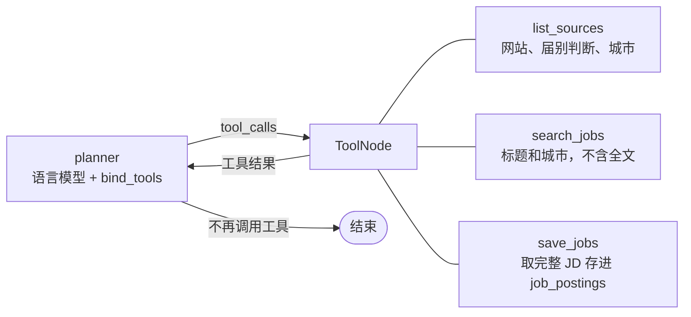
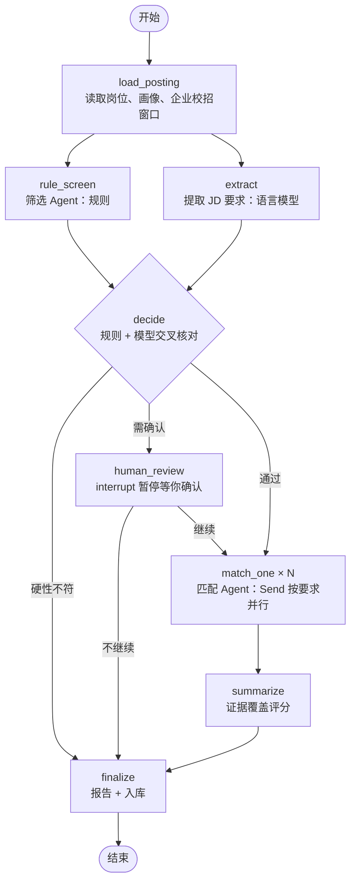
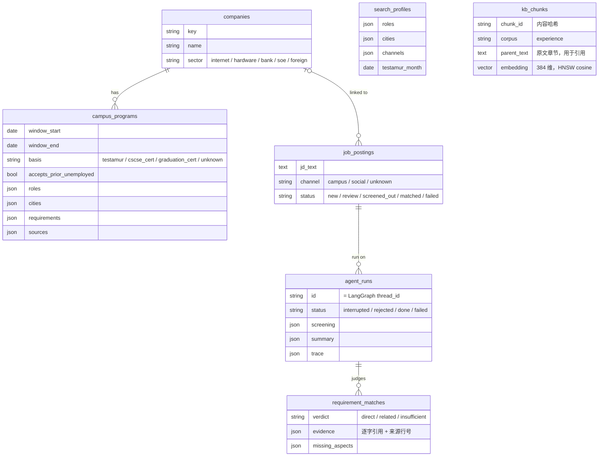

# 国内求职 Agent（cn-job-agent）

用多个 Agent 协作查找国内的 Agent 开发、AI 全栈、数据和技术支持岗位：先确认求职意向，再按届别窗口、城市和证据匹配筛选岗位。经历库和证据检索复用 [job_rag_starter](../job_rag_starter)。

> 当前完成 **P3 和材料 Agent**：搜索规划 Agent 从企业校招官网采集岗位，LangGraph 调度筛选 Agent 和匹配 Agent，给出带原文引用的中文匹配报告；材料 Agent 为匹配好的岗位写定制中文简历和 BOSS 直聘打招呼语；网页界面可以实时看 Agent 的执行轨迹，并在网页上批准或放弃暂停的运行。

## 材料 Agent：中文简历和打招呼语

对一次已完成证据匹配的运行，按这份 JD 写：求职意向、个人简介、按证据强弱挑选的 2 到 4 个项目（每个 3 到 4 条要点）、按 JD 相关度重新排序的技能，以及 150 字以内的 BOSS 直聘打招呼语。

| 规则 | 怎么保证 |
| --- | --- |
| 只用经历库原文 | 每条要点、简介和打招呼语都要在 `cites` 里列出依据的经历章节编号，项目要点只能引用本项目的章节 |
| 不新增事实 | 程序逐条检查：英文工具名和每个数字都必须出现在引用的原文里；"多 Agent""工具调用""生产环境""Agent 系统"这类定性说法也必须原文里有 |
| 表述边界 | 拦截管理员侧 IT 经验、服务台工作经历、实习、"显著提升"等夸大说法、内部核对用语和团队人数 |
| 不通过就重写 | 校验结果作为错误说明交回模型重写（沿用 job_rag_starter 的尝试次数）；仍不通过的单条内容被删除并在页面上列出 |
| 个人信息不出本机 | 姓名、电话、邮箱、教育背景从本机的中文简历底稿（`.env` 里的 `CN_RESUME_BASE`）填入，不发给模型；项目的角色和时间也以底稿为准 |

```powershell
.\.venv\Scripts\cn-agent.exe materials <运行编号>   # 也可以在网页的岗位详情 →"申请材料"里生成
```

每次生成存一个版本：`outputs/<运行编号>/materials/<时间>/` 下有 `resume_zh.docx`、`resume_zh.md`、`greeting.txt` 和带引用的 `materials.json`。

## 网页界面（P3）

```powershell
cd frontend; npm ci; npm run build; cd ..
.\.venv\Scripts\cn-agent.exe serve        # http://127.0.0.1:8100，只在本机可访问
```

| 页面 | 内容 |
| --- | --- |
| 概览 | 岗位状态统计、当前模型和数据去向、求职画像、最近运行、所有岗位里最常缺证据的技能要求 |
| 岗位 | 按状态筛选、搜索、按证据分数排序；添加 JD 后可以直接运行 Agent |
| 岗位详情 | 证据覆盖、逐条要求的判断和逐字引用（含来源文件和行号）、筛选结果、企业校招窗口、JD 原文；暂停的运行可以在这里批准或放弃 |
| Agent 轨迹 | 用编译后 LangGraph 图的真实拓扑画图，高亮实际走过的路径（条件分支只高亮实际执行的那条），列出每个节点的耗时；运行中通过 SSE 实时更新 |
| 采集 | 每次采集的搜索计划、保存的岗位和理由，Agent 模式下逐条回放工具调用 |
| 企业校招 | 按城市看 2027 届校招项目和届别判断 |

后端是 FastAPI：Agent 运行和采集在后台线程池里执行，接口立即返回编号；`graph.stream(stream_mode="updates")` 的每个节点更新变成一条 Server-Sent Event 推给浏览器。前端是 React 18 + TypeScript + Vite + React Router，没有 UI 组件库，样式用 CSS 变量，支持浅色、深色和手机宽度。开发时 `npm run dev` 在 5173 端口启动，`/api` 代理到 8100。

## 搜索规划 Agent（P2）



| 部分 | 说明 |
| --- | --- |
| 采集工具 | 读取企业校招官网自己页面调用的公开 JSON 接口，不登录、不过验证码、每个网站每秒最多 1 次请求。目前支持腾讯（join.qq.com）和 zhiye 平台上的科大讯飞、传音；新网站加一个 collector 即可 |
| Agent 模式 | LangGraph 工具调用循环：模型自己决定在哪个网站搜什么关键词，读搜索结果的标题，判断哪些岗位符合求职画像再保存，每次保存写一句理由。工具只返回标题和城市，模型必须先搜到才能保存 |
| 规则模式 | 同样三个工具、固定计划：每个届别窗口没排除的网站 × 每个岗位关键词，保留标题含关键词、在目标城市、不是实习和资深岗的结果。英文关键词按整词匹配（RAG 不会匹配 storage） |
| auto 模式 | 模型可用且工具调用成功就用 Agent，否则自动改用规则模式，原因记在采集记录里 |
| 采集记录 | `collection_runs` 表保存每次搜了什么、看到和保存了多少、Agent 的每次工具调用 |

```powershell
.\.venv\Scripts\cn-agent.exe collect                     # auto 模式
.\.venv\Scripts\cn-agent.exe collections --trace         # 看 Agent 的工具调用过程
.\.venv\Scripts\cn-agent.exe run --pending --limit 5     # 依次筛选、匹配新采集的岗位
.\.venv\Scripts\cn-agent.exe schedule install --time 09:00   # Windows 任务计划：每天采集并处理
```

## Agent 图（P1）



| 节点 | 做什么 |
| --- | --- |
| `rule_screen` | 不用模型，逐句检查工作年限、博士学历、第一学历 985/211、QS 排名、年龄、实习岗、外语、城市，以及已知企业的校招届别窗口。每条结论都附 JD 原文 |
| `extract` | 复用 job_rag_starter 的 `jd_parser`：语言模型把 JD 拆成逐条要求，引用必须能在原文里逐字找到 |
| `decide` | 规则结论和模型提取的经验要求交叉核对：硬性不符直接筛掉，有疑问的交给你确认；模型单方面的判断从不直接筛掉岗位 |
| `human_review` | `interrupt()` 暂停，进度存在 PostgreSQL（`PostgresSaver`）；隔天在另一个进程里 `--approve` 也能接着跑 |
| `match_one` | 用 `Send` 每条要求一个分支并行跑，复用 job_rag_starter 的 `EvidenceMatcher`（direct / related / insufficient 和逐字引用校验），检索换成 pgvector |
| `finalize` | 写 `outputs/<运行编号>/report.md` 和 `result.json`，结果写进 `agent_runs` 和 `requirement_matches` 表 |

运行失败时（比如模型服务断了），已完成的分支保存在检查点里，`cn-agent run --resume <运行编号>` 只重跑没完成的部分。

## P0 包含什么

| 部分 | 说明 |
| --- | --- |
| PostgreSQL 17 + pgvector | `compose.yaml` 一键启动；Alembic 管理表结构 |
| 复用 job_rag_starter | 按文件路径只读加载它的 `search_experience.py`：章节切分、个人贡献优先、token 窗口、排序都用同一份代码，经历库也只有一份 |
| 持久化向量检索 | 旧系统每次运行都在内存里重新编码；这里把 E5 向量存进 pgvector（HNSW 索引），只重新编码内容变了的片段。`cn-agent parity` 验证结果和旧系统一致 |
| 校招窗口数据 | `data/seed/campus_2027.yaml`：约 100 家大企业的 2027 届毕业时间窗口、城市、岗位、限制条件和来源链接，整理自 2026-11-21 的联网调研 |
| 届别判断 | `eligibility.py`：按学位证月份（或留服认证日期）判断每个校招项目是否符合，窗口卡在当月的标为"卡在边界" |
| 求职画像 | `profile.local.yaml`（不进 git）：岗位类型、城市、渠道和判断届别用的日期 |

## 表结构



## 快速开始（Windows PowerShell）

需要 Python 3.11+、Docker Desktop，以及本机的 job_rag_starter（经历库和缓存好的 E5 模型）。

```powershell
py -3.14 -m venv .venv
.\.venv\Scripts\python.exe -m pip install -e ".[test]"
Copy-Item .env.example .env                       # 改掉 POSTGRES_PASSWORD 和 CN_DATABASE_URL 里的密码
Copy-Item profile.example.yaml profile.local.yaml # 填自己的岗位、城市和学位证月份
docker compose up -d db
.\.venv\Scripts\cn-agent.exe setup                # 迁移 + 导入校招数据 + 画像 + 经历入库
.\.venv\Scripts\cn-agent.exe doctor
```

匹配一个 JD（需要配置好的语言模型，见下面"语言模型"一节）：

```powershell
.\.venv\Scripts\cn-agent.exe llm check
.\.venv\Scripts\cn-agent.exe jd add --file examples\sample_jd_agent.txt --city 深圳 --channel social
.\.venv\Scripts\cn-agent.exe jd add --clipboard --company 某公司 --city 杭州   # 从剪贴板粘贴
.\.venv\Scripts\cn-agent.exe run 1                                         # 筛选 + 匹配
.\.venv\Scripts\cn-agent.exe run --resume <运行编号> --approve              # 回答"是否继续"
.\.venv\Scripts\cn-agent.exe runs
.\.venv\Scripts\cn-agent.exe graph                                         # 打印 Agent 图
```

`examples/sample_jd_agent.txt` 是虚构的示例 JD。

常用命令：

```powershell
.\.venv\Scripts\cn-agent.exe search "RAG 检索增强 证据校验"
.\.venv\Scripts\cn-agent.exe parity "Agent 开发" "数据分析 SQL" "技术支持 工单"
.\.venv\Scripts\cn-agent.exe companies              # 画像城市里届别符合或待核实的项目
.\.venv\Scripts\cn-agent.exe companies --city 武汉 --all
```

测试（`pg` 标记的测试会新建并删除一个 `*_test` 数据库）：

```powershell
.\.venv\Scripts\python.exe -m pytest
```

## 语言模型

JD 要求提取、逐条证据判断和搜索规划 Agent 的工具调用用同一个模型，在 `.env` 里选：

| `CN_LLM_PROVIDER` | 服务 |
| --- | --- |
| `local` | 本机模型（job_rag_starter 的 `config.local.json`），数据不出本机 |
| `deepseek` · `qwen` · `zhipu` · `moonshot` · `doubao` · `siliconflow` | DeepSeek、通义千问（阿里云百炼）、智谱 GLM、Kimi、豆包（火山方舟）、硅基流动 |
| `openai` · `anthropic` · `gemini` | OpenAI、Claude、Gemini（后两个走官方的 OpenAI 兼容接口） |
| `openai_compatible` | 其他 OpenAI 兼容服务，配 `CN_LLM_BASE_URL` |

云端服务需要 `CN_LLM_MODEL`（模型名以服务商文档为准）和 `CN_LLM_API_KEY`（或服务商的标准环境变量，如 `DEEPSEEK_API_KEY`）。所有云端服务都通过 OpenAI 兼容接口调用：JSON 任务仍经过 job_rag_starter 的适配器，重试、结构校验和逐字引用校验都不变；搜索规划用 LangChain 的 `ChatOpenAI` 做工具调用。

```powershell
.\.venv\Scripts\cn-agent.exe llm providers
.\.venv\Scripts\cn-agent.exe llm check --ping    # 当前模型、数据去向，并实际测 JSON 输出和工具调用
```

## 数据与隐私

- `.env`（含 API key）、`profile.local.yaml` 不进 git。经历库留在 job_rag_starter 里，这个仓库不复制任何经历原文。
- 向量和经历片段存在本机的 PostgreSQL 里。
- **用云端 API 时**，JD、求职画像和检索到的经历片段会发送给所选服务商，保留政策以服务商条款为准；`cn-agent llm check` 会写明数据发往哪里。本机模型不会自动换成云端 API，服务商永远由你在 `.env` 里明确选择。LangSmith 追踪始终关闭。
- 校招数据大多来自高校就业网转载和第三方聚合站（`confidence` 字段标明），**投递前一定以企业官网公告为准**。

## 路线图

| 阶段 | 内容 |
| --- | --- |
| P0 ✅ | 仓库骨架、Postgres + pgvector、复用 RAG 核心、校招窗口数据 |
| **P1 ✅** | 粘贴 JD → 筛选 Agent（届别、经验年限、学历门槛、年龄）→ 匹配 Agent（逐条要求的证据判断），用 LangGraph 串起来，可暂停、可续跑 |
| **P2 ✅** | 校招官网采集工具、搜索规划 Agent（工具调用 + 规则兜底）、待处理队列、定时任务 |
| **P3 ✅** | FastAPI + React 网页界面、SSE 实时 Agent 轨迹、网页上批准 / 放弃暂停的运行 |
| **材料 Agent ✅** | 定制中文简历（Word / Markdown）和 BOSS 直聘打招呼语，逐条引用、程序校验 |
| 下一步 | 面试准备、虚构数据的公开演示版 |
